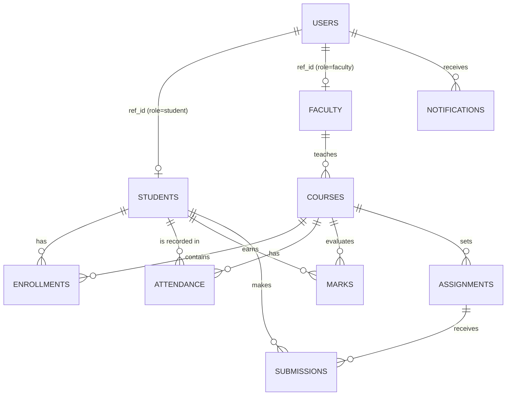

# Database design (SQLite)

Defined in `database/schema.py`. Foreign keys are enforced (`PRAGMA foreign_keys = ON`).

| Table | Purpose / key columns |
|---|---|
| users | username (unique), password_hash, role, ref_id, is_active, must_reset, failed_attempts, locked_until |
| students | student_id (PK, e.g. AIML2026001), name, email (unique), mobile, department, semester, division, previous_percentage |
| faculty | faculty_id (PK), name, email (unique), department |
| courses | course_id, course_code (unique), course_name, department, semester, credits, has_practical, faculty_id |
| enrollments | student_id, course_id - UNIQUE pair |
| attendance | student_id, course_id, lecture_date, status - UNIQUE (student, course, date) |
| marks | student_id, course_id, exam_type (Internal/Practical/External), marks - UNIQUE (student, course, type) |
| assignments / submissions | assignment per course; submitted flag per student |
| notifications | user_id, message, is_read |
| announcements | title, description, created_by |
| settings | grade_scale, max_marks, attendance_threshold, institution_name |
| historical_records | past-cohort features + outcome used to train the ML model |

## Integrity rules
* Student IDs are unique (primary key); emails are unique.
* One attendance row per student, course and lecture date (database constraint).
* Marks must be >= 0 (CHECK) and <= the configured maximum (validated in `save_marks`).
* Deleting a student cascades to enrolments, attendance, marks, submissions, their login and notifications.
* Passwords are stored only as hashes.
* Students can only read rows where `student_id` equals their own `ref_id` (enforced in the UI layer and chatbot).
